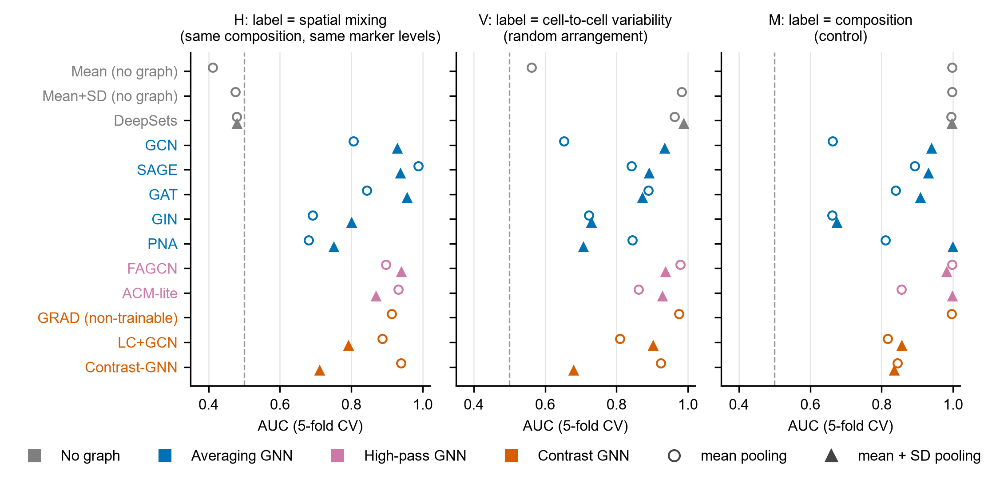
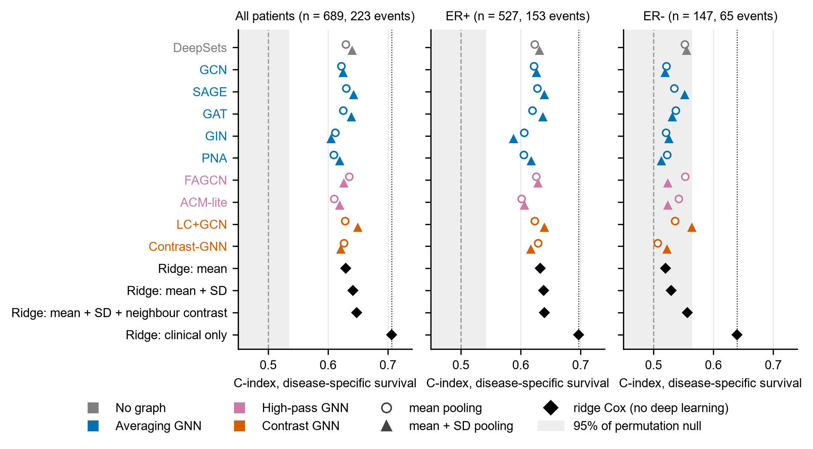
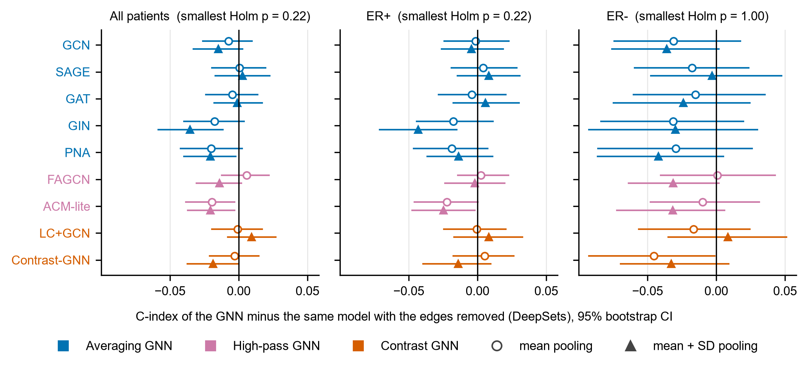
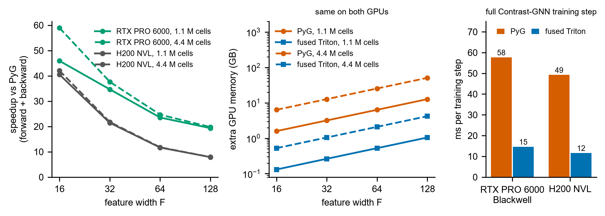

# Contrast vs averaging GNNs for survival prediction from spatial proteomics

Graph neural networks on tissue usually **average** each cell with its neighbours. Averaging is a
low-pass filter, so it removes cell-to-cell differences. If prognosis depends on how different
neighbouring cells are, a **contrast** operator should keep that signal:

$$c_i = \frac{1}{|N(i)|}\sum_{j \in N(i)} \lvert h_i - h_j \rvert$$

This repo tests that idea on simulated tissue and on a public breast cancer imaging mass cytometry
cohort. It also includes a fused GPU kernel for the contrast operator, written in Triton and
benchmarked on an NVIDIA RTX PRO 6000 Blackwell and an H200.

## Headline

- **Simulated tissue.** When the label depended only on how cells were arranged, models without a
  graph were at chance (AUC 0.41 to 0.48) and graph models recovered it (0.68 to 0.99). When the label
  was cell-to-cell variability, adding SD pooling rescued an averaging GNN (GCN 0.65 to 0.94).
- **METABRIC breast cancer, 689 patients, 1.1 M cells.** All 20 GNNs predicted disease-specific
  survival better than chance (C-index 0.60 to 0.65, permutation p = 0.0002). None beat the same
  model with the graph edges removed: **0 of 54** pre-specified tests were significant after Holm
  correction. Simple ridge Cox models on per-patient marker means and SDs did as well as the GNNs,
  and clinical variables alone did better (0.706).
- **Interpretation.** On this cohort, survival signal came mainly from cell composition, overall
  cell-to-cell variability and clinical factors. Neighbour-level spatial heterogeneity added no
  measurable predictive value. Whether a heterogeneity-preserving GNN helps depends on where the
  signal lives in a given tissue and outcome.
- **GPU kernel.** The fused contrast operator matches PyTorch Geometric to a relative error of
  3e-7, runs 8 to 59x faster, uses 12x less memory, and makes a full training step about 4x faster.

## Figures

### 1. Simulated tissue: which models can see which signal



AUC for 13 architectures in three simulated scenarios (200 patients, about 600 cells each, 10
markers, Delaunay graphs). **H:** the label is how spatially mixed two cell types are, with
composition and marker levels identical between classes, so only the arrangement differs.
**V:** the label is within-type marker variability. **M:** the label is composition (control).
Circles use mean pooling; triangles use mean + SD pooling.

No-graph models are at chance on H, as designed. Graph models recover it, including some
averaging GNNs (SAGE 0.99), so averaging alone did not destroy the signal here. On V, mean
pooling hides variability and SD pooling restores it. A seed check (`results/synthetic/seedcheck.json`)
showed single-seed AUCs of trainable GNNs varying by up to 0.33 between seeds, so the ranking
between individual architectures in this figure is not reliable.

### 2. METABRIC: every model, three patient groups



Out-of-fold C-index for disease-specific survival, 5-seed ensembles, on fixed 5-fold patient
splits shared by every model. The grey band is the 95th percentile of a 5,000-permutation null,
and the dotted line is clinical variables alone (grade, nodes, tumour size, ER). In ER+ disease all
models are well above the null. In ER- disease (65 events) no tissue model clearly beats chance.

### 3. METABRIC: does the graph help? (pre-specified primary test)



Each GNN minus its edge-removed twin (DeepSets, the same encoder and pooling with no message
passing), on identical splits. Bars are patient-bootstrap 95% CIs, not corrected for multiple
testing. P-values come from two-sided paired permutation tests (5,000), Holm-corrected across all
54 tests. No difference survives correction, and the uncorrected differences that exclude zero
favour the model **without** edges. Table: `results/metabric/graph_vs_no_graph_bootstrap_ci.csv`.

### 4. Fused GPU kernel for the contrast operator



Left: forward + backward speedup over PyTorch Geometric for feature widths 16 to 128, on the
METABRIC graph (1.1 M cells, 6.4 M edges) and a 4x copy. Middle: extra GPU memory. Right: one full
Contrast-GNN training step on all METABRIC images.

## METABRIC results table

Disease-specific survival, all 689 patients (223 events), 5-seed ensembles:

| Model | C-index |
|---|---:|
| Ridge Cox, clinical only (grade, nodes, size, ER) | **0.706** |
| Best GNN: LC+GCN with SD pooling | 0.649 |
| Ridge Cox, marker mean + SD + neighbour contrast | 0.648 |
| Ridge Cox, marker mean + SD (no graph) | 0.642 |
| DeepSets with SD pooling (GNN with edges removed) | 0.640 |
| Ridge Cox, marker mean (no graph) | 0.630 |
| Contrast-GNN / GCN / GIN / PNA | 0.627 / 0.622 / 0.612 / 0.610 |

Every model has permutation p = 0.0002 (the smallest possible with 5,000 permutations).
Pre-specified comparison families, two-sided paired permutation, Holm within family:

| Comparison | Tests | Significant after Holm |
|---|---:|---:|
| GNN vs edge-removed twin, DSS (all, ER+, ER-) | 54 | 0 |
| Contrast GNN vs averaging GNN | 24 | 0 |
| SD pooling vs mean pooling | 30 | 0 |
| GNN vs ridge baselines | 24 | 0 |
| GNN vs edge-removed twin, overall survival | 18 | 0 |
| Clinical + tissue features vs clinical alone (ridge, DSS and OS) | 6 | 0 |

Full tables: `results/metabric/cindex_table.csv` and `comparisons.csv`; the log is `analysis_log.txt`.

## Kernel results table

The PyG operator builds an E x F tensor of neighbour differences before averaging. The fused kernel
(`kernel/contrast_triton.py`) walks a CSR adjacency sorted by destination, accumulates in registers,
and writes only the N x F output. The backward pass is a second gather over the same CSR with no
atomics, using the fact that tissue graphs are symmetric:

$$\frac{\partial L}{\partial h_k} = \sum_{j \in N(k)} \operatorname{sign}(h_k - h_j)\left(\frac{g_k}{\deg_k} + \frac{g_j}{\deg_j}\right)$$

Forward and gradient match PyG to a relative error below 3e-7 on random graphs with isolated nodes
and on the full METABRIC graph. Timings are medians from `triton.testing.do_bench`, in fp32:

| | RTX PRO 6000 Blackwell | H200 NVL |
|---|---|---|
| Operator speedup, forward + backward, F = 16 / 32 / 64 / 128 | 46x / 35x / 24x / 19x | 40x / 21x / 12x / 8x |
| Same on a 4x graph (4.4 M cells, 25.6 M edges) | 59x / 38x / 25x / 20x | 42x / 22x / 12x / 8x |
| Extra memory, F = 128, 4.4 M cells | 51.0 GB to 4.2 GB | same |
| Full training step | 57.7 to 14.6 ms (3.9x) | 49.2 to 11.6 ms (4.2x) |
| Peak memory, training step | 5.4 to 2.5 GB | 5.5 to 2.6 GB |

The kernel alone was faster on Blackwell, while the full training step was faster on the H200. Each
GPU was measured in one job. `torch.compile` could not be compared, because it does not support
Python 3.14, which the cluster's PyTorch module used.

## Design

- **Pre-specified.** The task panel (DSS in all, ER+ and ER- patients) and the primary test
  (graph model vs edge-removed twin on identical splits) were fixed before any GNN result was seen.
- **Models.** 10 architectures, each with mean pooling and with mean + SD pooling (20 models):
  no graph (DeepSets); averaging (GCN, GraphSAGE, GAT, GIN, PNA with a std aggregator); high-pass
  (FAGCN, ACM-lite); contrast (LC+GCN, which appends |x_i - mean of neighbours| to the input, and
  Contrast-GNN, which uses the operator above as a trainable layer). Each has 2 graph layers and
  32 hidden units, followed by BatchNorm on the pooled vector, an MLP, and a Cox loss.
- **Training.** Full-batch on one GPU, Adam (lr 3e-3), early stopping on an inner validation set.
  2 endpoints x 20 models x 5 folds x 5 seeds = 1,000 runs.
- **Statistics.** All p-values come from measured nulls: permutation of out-of-fold scores for
  "better than chance", and paired permutation for model vs model. Holm correction is applied within
  each comparison family.
- **Baselines.** Ridge Cox on per-patient marker means, means + SDs, and means + SDs + neighbour
  contrast, with the penalty chosen by inner CV on the same folds. Clinical variables were reported
  as a reference only.
- **Not run.** External validation (train on the Jackson et al. 2020 Basel cohort, test on Zurich)
  was pre-specified. With no internal gain from the graph, there was nothing to validate.

## Caveats

METABRIC alone is one cohort, one tissue and one imaging panel. A spatial gain in another disease,
or for an outcome with more events, is not ruled out; ER- disease had only 65 events. Graphs are
the authors' published neighbour pairs, and other graph constructions were not tried.
Hyperparameters were fixed, not tuned per model. Numbers are not directly comparable with
published METABRIC GNN results, because the patient sets, splits and endpoints differ.

## Related work

- Danenberg et al. 2022 found spatial tissue structures in METABRIC associated with DSS in ER+
  disease. This repo asks a different question: whether those structures add predictive value
  beyond composition, in a cross-validated test against a matched no-graph model.
- Ali et al. 2025 found that standard GNNs did not significantly beat single-cell or pseudobulk
  baselines on the same public datasets, mostly for tumour grade.
- SpaCEy (2026) reports METABRIC overall-survival C-index 0.688 for its GNN against 0.570 for its
  best non-spatial baseline. The non-spatial baselines here are stronger (0.616 to 0.623 on OS), and
  the edge-removed twin isolates the contribution of the graph itself.
- Neighbour-difference and high-pass operators are known in general graph learning (FAGCN,
  ACM-GNN). They are applied here to spatial proteomics outcomes and compared against matched controls.

## Data

METABRIC imaging mass cytometry, Danenberg et al. 2022, Zenodo
[7324285](https://zenodo.org/records/7324285) (v2.1.0, CC BY 4.0). The cohort has 761 images from
689 patients, 1,101,198 cells, 36 proteins, and 6.4 M neighbour edges. Disease-specific survival
comes from the dataset's clinical table. Overall survival comes from the public cBioPortal study
`brca_metabric` (595 patients). The data is not redistributed here.

## Reproduce

```bash
pip install -r requirements.txt

# 1. simulated tissue (CPU)
python scripts/01_synthetic_pilot.py --levels hard
python scripts/01b_seed_check.py

# 2. METABRIC data and non-GNN baselines (CPU)
bash scripts/02a_download_metabric.sh            # 0.9 GB from Zenodo, md5-checked
python scripts/02b_build_metabric.py             # graphs.pt, patients.csv, folds.csv
python scripts/02c_baselines_metabric.py
python scripts/02d_clinical_plus_tissue.py

# 3. GNNs (GPU, SLURM; about 4 h of training time in total), run from the repo root
sbatch gnn/run_pilot.sbatch
NPROC=4 sbatch --export=ALL gnn/run_full.sbatch
python scripts/03_analyze_gnn.py                 # needs results/02_gnn/preds from the GPU run

# 4. kernel benchmark (GPU, a few minutes per GPU type)
sbatch --partition=<your-gpu-partition> kernel/run_kernel.sbatch
python scripts/04_summarize_kernel.py

# 5. figures (from the saved results)
python scripts/05_figures.py
```

`gnn/env_setup.sh` loads a cluster PyTorch module and builds a venv on top of it. Adapt that one
file to your cluster. The kernel can be checked without a GPU through Triton's interpreter:
`TRITON_INTERPRET=1 python kernel/bench_kernel.py --local-test`.

## Repository layout

```
scripts/   CPU pipeline: simulation, data build, ridge baselines, analysis, figures
gnn/       GPU training: models.py (all 20 models), train_gnn.py, SLURM scripts
kernel/    contrast_triton.py (fused forward + backward), bench_kernel.py, SLURM script
results/   synthetic/, metabric/, kernel/: every number in this README
figures/   PNG and SVG
```

## References

- Danenberg E. et al. Breast tumor microenvironment structures are associated with genomic features and clinical outcome. *Nature Genetics* 54:660-669, 2022. [doi:10.1038/s41588-022-01041-y](https://doi.org/10.1038/s41588-022-01041-y)
- Ali M. et al. Graph neural networks learn emergent tissue properties from spatial molecular profiles. *Nature Communications*, 2025. [doi:10.1038/s41467-025-63758-8](https://doi.org/10.1038/s41467-025-63758-8)
- SpaCEy. *Nature Communications*, 2026. [doi:10.1038/s41467-026-77924-z](https://doi.org/10.1038/s41467-026-77924-z)
- Jackson H.W. et al. The single-cell pathology landscape of breast cancer. *Nature* 578:615-620, 2020.
- Bo D. et al. Beyond low-frequency information in graph convolutional networks (FAGCN). *AAAI*, 2021.
- Luan S. et al. Revisiting heterophily for graph neural networks (ACM-GNN). *NeurIPS*, 2022.
- Tillet P. et al. Triton: an intermediate language and compiler for tiled neural network computations. *MAPL*, 2019.

## Licence

Code is released under the [MIT licence](LICENSE). The METABRIC IMC data is CC BY 4.0 and is not
redistributed here.
